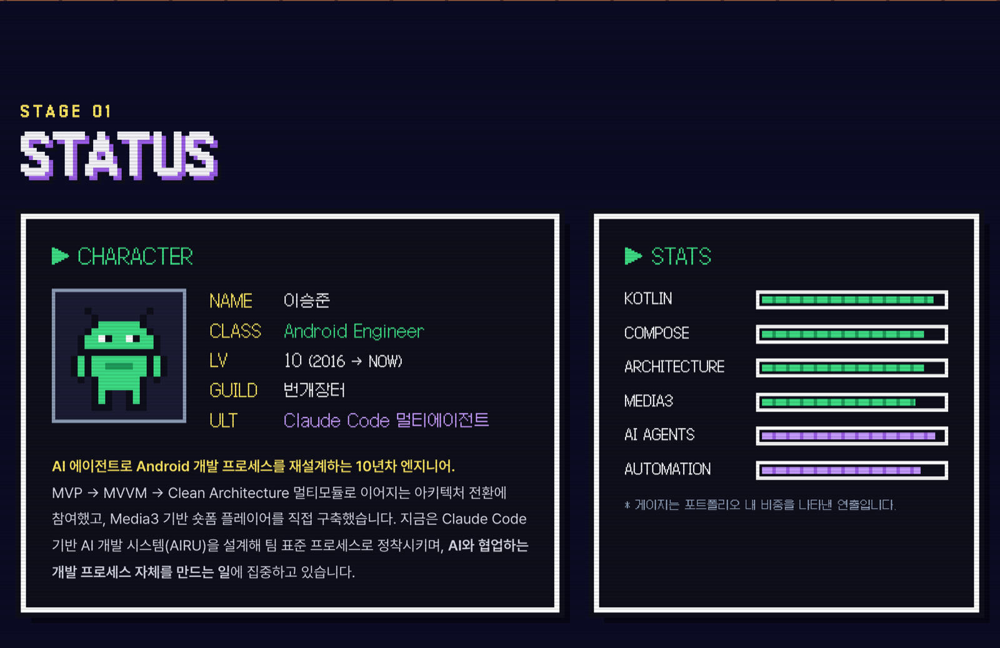
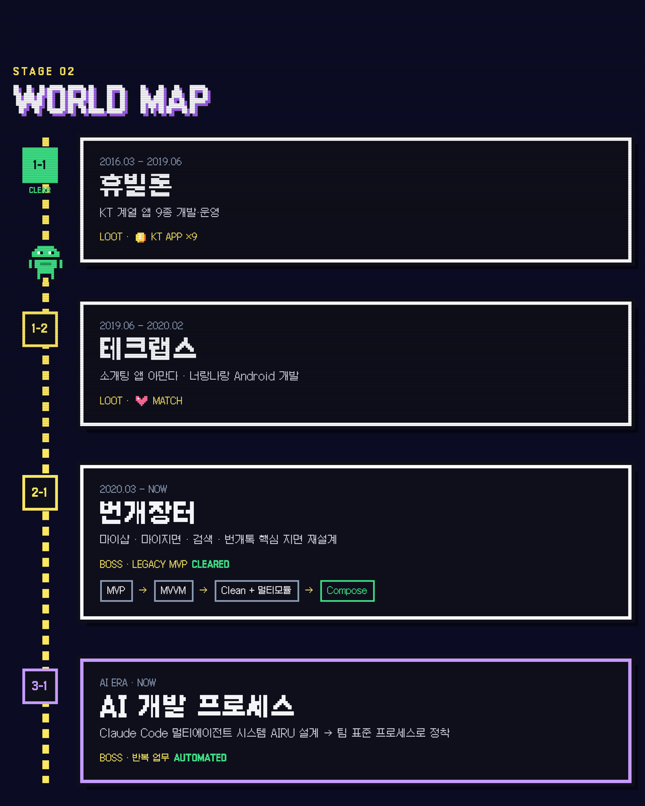
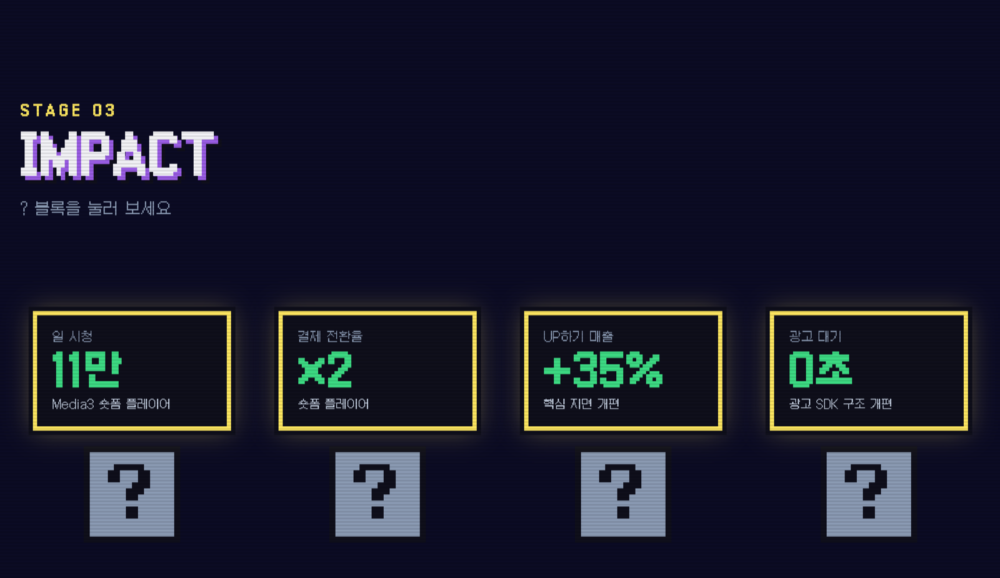
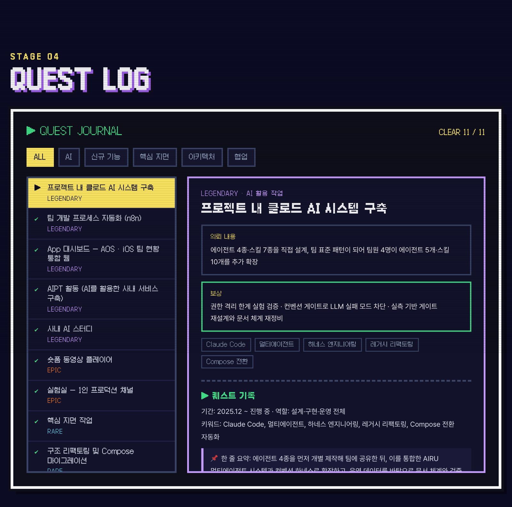
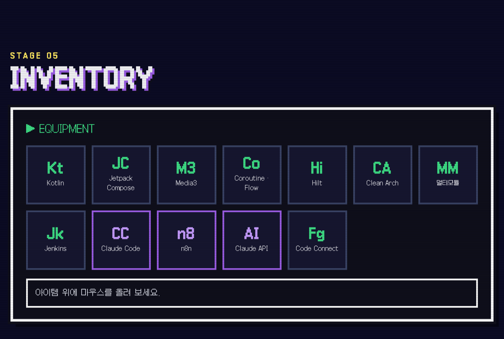
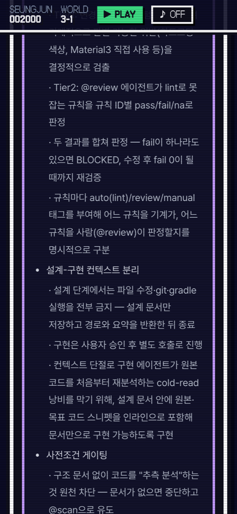

# SEUNGJUN QUEST — 포트폴리오 웹사이트

레트로 픽셀 게임 컨셉의 이력서·포트폴리오 사이트. 빌드 도구 없는 정적 사이트다.

- 사이트: https://seungjun-quest.pages.dev
- 만든 과정: [이력서를 게임으로 만들었다 (velog)](https://velog.io/@haul/resume-to-pixel-game-with-claude-code) — 노션 포트폴리오를 Claude Code 와 함께 픽셀 게임 사이트로 옮긴 기록


## 미리보기

### 사이트 둘러보기


[고화질 영상 (mp4)](docs/media/tour.mp4)

### 직접 플레이하는 게임

경력을 스테이지로 옮긴 횡스크롤 게임. 방향키로 이동, Z 점프, X 공격.


[고화질 영상 (mp4)](docs/media/gameplay.mp4)

### 섹션

| STATUS | WORLD MAP |
|---|---|
|  |  |
| **IMPACT** | **QUEST LOG** |
|  |  |
| **INVENTORY** | **모바일** |
|  |   |

## 로컬에서 보기

```bash
python3 -m http.server 4173
# http://localhost:4173
```

게임 자동 테스트용 진입점 `window.__quest` 는 주소에 `?debug` 를 붙였을 때만 생긴다 (`http://localhost:4173/?debug`).

## 구성

| 파일 | 역할 |
|---|---|
| `index.html` | 섹션 마크업 (TITLE · STATUS · WORLD MAP · IMPACT · QUEST LOG · INVENTORY · CONTINUE) |
| `styles.css` | 픽셀 UI, CRT 효과, 반응형, 모션 줄이기 대응 |
| `main.js` | 프로젝트·기술 데이터, 스크롤 연출, ? 블록, 퀘스트 저널, 8비트 효과음, 코나미 커맨드 |
| `game.js` | 직접 플레이 게임 (캔버스 320×192, 스테이지 5개, 키보드·터치) |
| `data/quests-detail.json` | 퀘스트 저널에 보이는 노션 프로젝트 상세 본문 |
| `sprites.js` | 픽셀 스프라이트 정의 (소개 영상과 같은 캐릭터) |
| `worker.js` | 영상·음악 Range 응답(206). 배포 때 `_worker.js` 로 올라간다 |
| `build.sh` | 배포용 `dist/` 폴더 만들기 |
| `_headers` | 정적 파일 보안 헤더 (CSP 등) |
| `docs/media/` | README 용 스크린샷·영상 (배포에는 포함되지 않음) |
| `assets/pixel-quest.mp4` | 메인 소개 영상 (Remotion 프로젝트 `android-portfolio-video` 의 `PixelQuest`) |

## 내용 고치기

- 프로젝트 카드: `main.js` 의 `QUESTS` 배열
- 기술 스택: `main.js` 의 `ITEMS` 배열
- 경력·소개: `index.html` 의 `#status`, `#map` 섹션
- 프로젝트 상세 본문: `data/quests-detail.json`
- 게임 스테이지(아이템·적·표지판 문구): `game.js` 의 `LEVELS` 배열

## 배포 (Cloudflare Pages)

```bash
./build.sh && npx wrangler pages deploy
```

- 주소: https://seungjun-quest.pages.dev
- `build.sh` 가 올릴 파일만 `dist/` 에 모은다. 새 파일을 추가하면 `build.sh` 의 복사 목록에도 넣는다.
- `worker.js` 는 `dist/_worker.js` 로 복사되고, `_routes.json` 에 적힌 영상·음악(`/assets/*.mp4`, `*.m4a`) 요청만 받아 Range 응답(206)을 만든다. 파일 전체를 메모리에 올리지 않고 스트림에서 요청한 구간만 잘라 보낸다. 정적 파일 응답은 Range 를 처리하지 않아 iOS Safari 에서 영상이 재생되지 않을 수 있기 때문이다.
- 보안 헤더는 루트의 `_headers` 에 있다 (`nosniff`, `Referrer-Policy`, `Permissions-Policy`, CSP). Cloudflare 가 정적 파일 응답에 붙인다. `worker.js` 를 거치는 영상·음악 응답에는 적용되지 않아 `worker.js` 가 `nosniff`·`Referrer-Policy` 를 직접 붙인다.
- CSP 가 `script-src 'self'`, `style-src 'self'` 이므로 HTML 에 인라인 `<script>`·`style` 속성을 쓰지 않는다. 동적인 스타일 값은 JS 에서 `element.style` 로 넣는다 (예: STATS 게이지의 `data-v`).
- 예전 주소(`seungjun-quest.eojeboda-weather.workers.dev`)는 `legacy-redirect/` 의 Worker 가 같은 경로의 새 주소로 301 이동시킨다. 배포: `cd legacy-redirect && npx wrangler deploy`

## 사용한 리소스

- 폰트: [Galmuri](https://github.com/quiple/galmuri) (SIL Open Font License)
- 영상 효과음: Kenney (CC0), BGM 은 Remotion 프로젝트(`android-portfolio-video/scripts/make-bgm.mjs`)로 직접 합성
