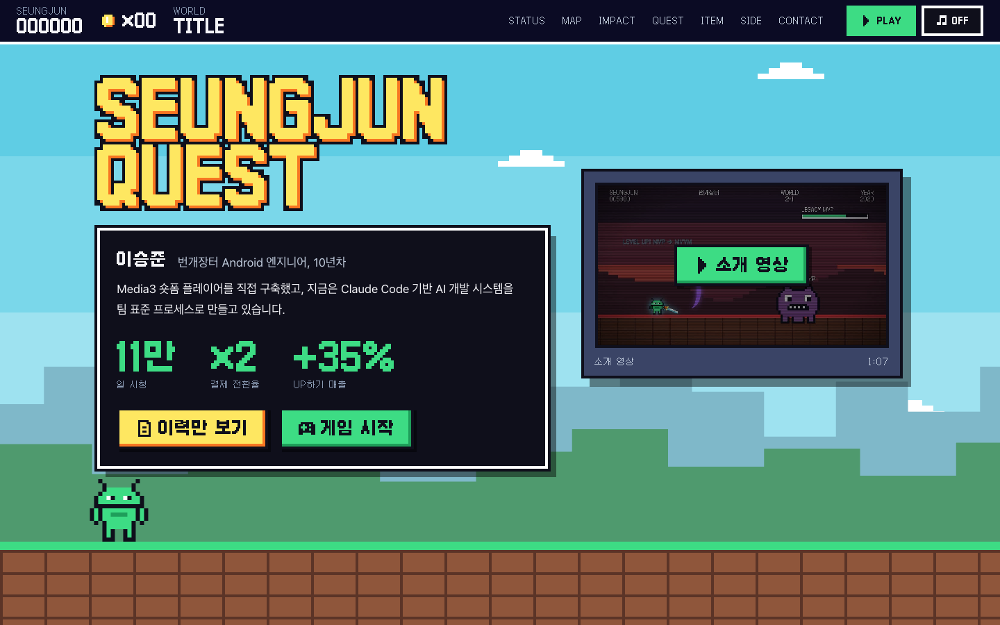
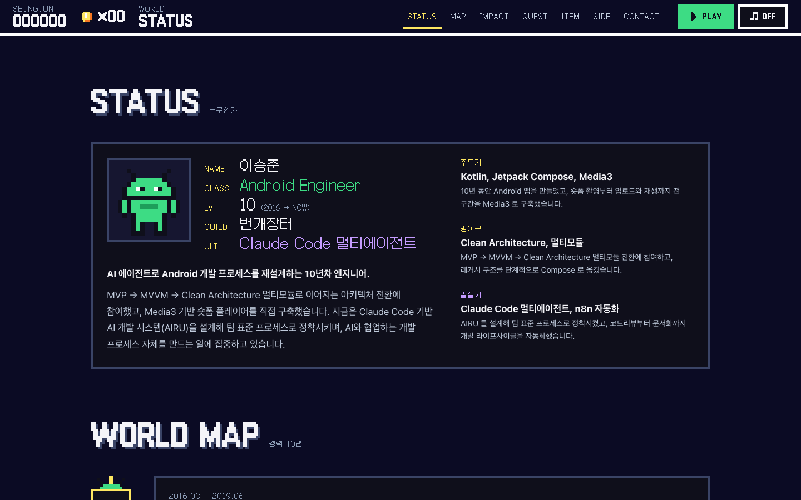
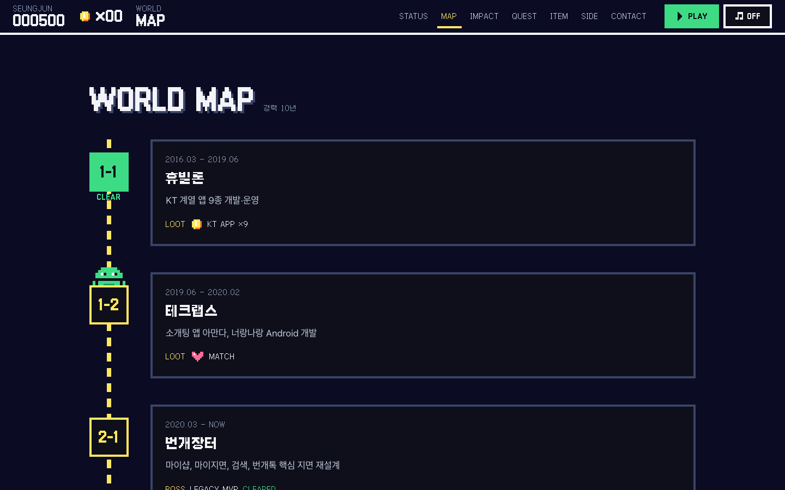
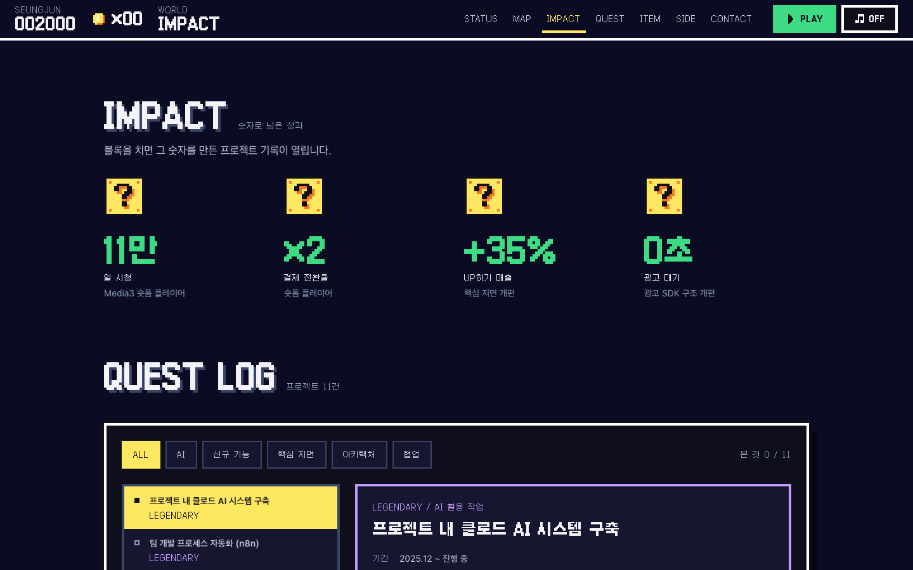
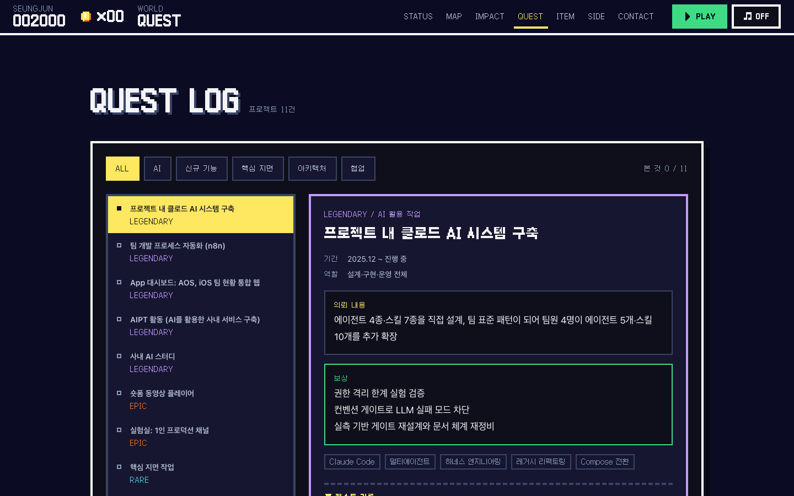
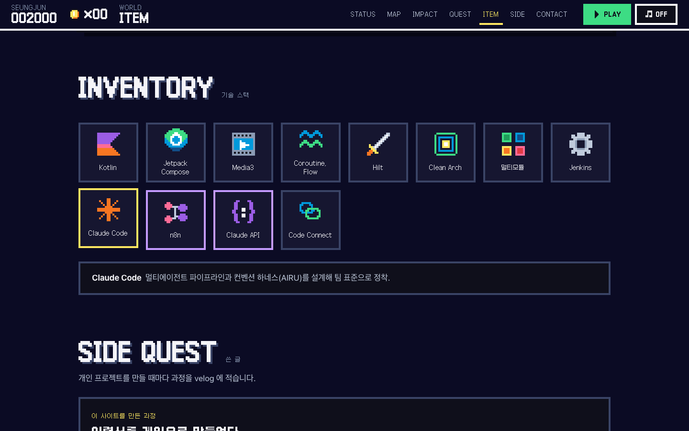
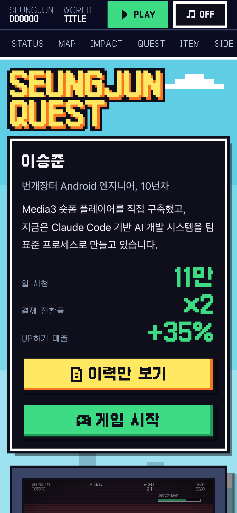
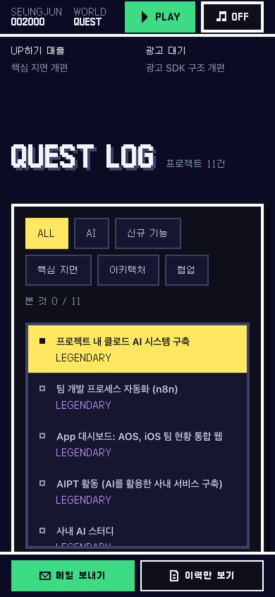

# SEUNGJUN QUEST — 포트폴리오 웹사이트

레트로 픽셀 게임 컨셉의 이력서·포트폴리오 사이트. 빌드 도구 없는 정적 사이트다.

- 사이트: https://seungjun-quest.pages.dev
- 만든 과정: [이력서를 게임으로 만들었다 (velog)](https://velog.io/@haul/resume-to-pixel-game-with-claude-code) — 노션 포트폴리오를 Claude Code 와 함께 픽셀 게임 사이트로 옮긴 기록



## 미리보기

### 사이트 둘러보기


[고화질 영상 (mp4)](docs/media/tour.mp4)

### 직접 플레이하는 게임

경력을 스테이지로 옮긴 횡스크롤 게임. 방향키(또는 A·D)로 이동, Z(또는 ↑·W·스페이스) 점프, X(또는 J) 공격, P 일시정지, M 소리, Esc 닫기. 모바일은 가상 패드.


[고화질 영상 (mp4)](docs/media/gameplay.mp4)

### 섹션

| STATUS | WORLD MAP |
|---|---|
|  |  |
| **IMPACT** | **QUEST LOG** |
|  |  |
| **INVENTORY** | **모바일** |
|  |   |

## 로컬에서 보기

```bash
python3 -m http.server 4173
# http://localhost:4173
```

게임 자동 테스트용 진입점 `window.__quest` 는 주소에 `?debug` 를 붙였을 때만 생긴다 (`http://localhost:4173/?debug`).

## 구성

| 파일 | 역할 |
|---|---|
| `index.html` | 내용의 원본. 섹션 마크업과 경력·성과·프로젝트 11건·기술·글 목록 (TITLE, STATUS, WORLD MAP, IMPACT, QUEST LOG, INVENTORY, SIDE QUEST, CONTINUE). 스크립트 없이도 전부 읽힌다 |
| `resume.html`, `resume.css` | 게임 없이 보는 한 장 이력서. 인쇄하면 흰 종이로 바뀐다 (PDF 저장용) |
| `404.html` | 없는 주소 안내 |
| `styles.css` | 색·글자·간격 토큰, 픽셀 UI, 반응형, 모션 줄이기 대응 |
| `boot.js` | `<head>` 에서 먼저 읽는 짧은 스크립트. 스크립트 사용 표식, 재방문 때 부팅 화면 건너뛰기, 스크립트 실패 시 정적 화면으로 되돌리기 |
| `lib.js` | DOM 없이 도는 순수 규칙 (게임 배율, 프로젝트 주소, 상세 첫 문단 나누기, 진행 기록) |
| `main.js` | `index.html` 위에 얹는 동작: 스크롤 연출, 성과 블록, 퀘스트 저널, 8비트 효과음, 코나미 커맨드 |
| `game.js` | 직접 플레이 게임 (캔버스 320×192, 스테이지 5개, 키보드·터치). PLAY 를 처음 누를 때 받는다 |
| `data/quests-detail.json` | 퀘스트 저널에 보이는 노션 프로젝트 상세 본문. 저널이 화면에 가까워질 때 받는다 |
| `sprites.js` | 픽셀 스프라이트 정의 (캐릭터, 버튼 아이콘, 인벤토리 아이템) |
| `tests/` | `node --test tests/*.test.mjs` 로 도는 테스트 (순수 규칙, 파일 사이 사실 일치) |
| `tools/subset-fonts.sh` | Galmuri11 서브셋 다시 만들기 |
| `fonts-src/` | Galmuri11 원본 (배포에는 포함되지 않음) |
| `worker.js` | 영상·음악 Range 응답(206). 배포 때 `_worker.js` 로 올라간다 |
| `build.sh` | 배포용 `dist/` 폴더 만들기 |
| `_headers` | 정적 파일 보안 헤더 (CSP 등) |
| `docs/media/` | README 용 스크린샷·영상 (배포에는 포함되지 않음) |
| `assets/pixel-quest.mp4` | 메인 소개 영상 (Remotion 프로젝트 `android-portfolio-video` 의 `PixelQuest`) |
| `assets/poster.jpg` | 소개 영상 포스터 (960×540) |
| `assets/og.jpg` | 링크 미리보기(OG) 이미지 (1200×630) |
| `assets/favicon.svg` 등 | 파비콘. `sprites.js` 의 캐릭터에서 뽑았다 |
| `assets/quest-bgm.m4a` | 게임 BGM |
| `assets/fonts/` | Galmuri11 보통·굵게 서브셋 (woff2, 이 사이트가 찍는 글자만) |
| `wrangler.jsonc` | Cloudflare Pages 프로젝트 이름과 출력 폴더(`dist`) |
| `legacy-redirect/` | 예전 Workers 주소를 새 주소로 넘기는 별도 Worker |

## 내용 고치기

- 프로젝트 목록: `index.html` 의 `#quest-list`. 항목 하나가 `<li id="quest/번호">` 이고 주소 `#quest/번호` 로 바로 열린다. 팀 규모는 `data-party` 에 적으면 상세에 "파티" 칸으로 나온다
- 기술 스택: `index.html` 의 `#slots`
- 경력·소개·성과: `index.html` 의 `#top`, `#status`, `#map`, `#impact`
- 글 목록: `index.html` 의 `#posts`
- 프로젝트 상세 본문: `data/quests-detail.json`. 첫 문단의 `기간: … · 역할: …` 은 상세 위쪽 칸으로 올라간다
- 게임 스테이지(아이템·적·표지판 문구): `game.js` 의 `LEVELS` 배열
- 한 장 이력서: `resume.html`

같은 사실(성과 수치, 경력 기간, 연락처)이 `index.html`, `resume.html`, `game.js` 에 적혀 있다. 한 곳만 고치면 `node --test tests/*.test.mjs` 가 어긋난 곳을 알려 준다.

픽셀 글꼴로 찍히는 문구(제목·라벨·버튼·게임 글자)에 새 글자를 넣었으면 `tools/subset-fonts.sh` 를 다시 돌린다. 안 돌리면 그 글자만 시스템 글꼴로 보인다. 글자 크기는 `styles.css` 의 `--t-*` 토큰만 쓴다. Galmuri11 은 12px 격자 글꼴이라 12 의 배수가 아니면 획이 고르지 않다.

## 테스트

```bash
for f in boot.js sprites.js lib.js main.js game.js worker.js; do node --check "$f"; done
node --test tests/*.test.mjs
```

Galmuri11 은 SIL Open Font License 1.1 글꼴이다 (© Lee Minseo).

## 배포 (Cloudflare Pages)

```bash
./build.sh && npx wrangler pages deploy
```

- 주소: https://seungjun-quest.pages.dev
- `build.sh` 가 올릴 파일만 `dist/` 에 모은다. 새 파일을 추가하면 `build.sh` 의 복사 목록에도 넣는다.
- `worker.js` 는 `dist/_worker.js` 로 복사되고, `_routes.json` 에 적힌 영상·음악(`/assets/*.mp4`, `*.m4a`) 요청만 받아 Range 응답(206)을 만든다. 파일 전체를 메모리에 올리지 않고 스트림에서 요청한 구간만 잘라 보낸다. 정적 파일 응답은 Range 를 처리하지 않아 iOS Safari 에서 영상이 재생되지 않을 수 있기 때문이다.
- 보안 헤더는 루트의 `_headers` 에 있다 (`nosniff`, `Referrer-Policy`, `Permissions-Policy`, CSP). Cloudflare 가 정적 파일 응답에 붙인다. `worker.js` 를 거치는 영상·음악 응답에는 적용되지 않아 `worker.js` 가 `nosniff`·`Referrer-Policy` 를 직접 붙인다.
- CSP 가 `script-src 'self'`, `style-src 'self'` 이므로 HTML 에 인라인 `<script>`·`style` 속성을 쓰지 않는다. 동적인 스타일 값은 JS 에서 `element.style` 로 넣는다 (예: STATS 게이지의 `data-v`).
- 예전 Workers 주소(`*.workers.dev`)는 `legacy-redirect/` 의 Worker 가 같은 경로의 새 주소로 301 이동시킨다. 배포: `cd legacy-redirect && npx wrangler deploy`

## 사용한 리소스

- 폰트: [Galmuri](https://github.com/quiple/galmuri) (SIL Open Font License)
- 영상 효과음: Kenney (CC0), BGM 은 Remotion 프로젝트(`android-portfolio-video/scripts/make-bgm.mjs`)로 직접 합성
