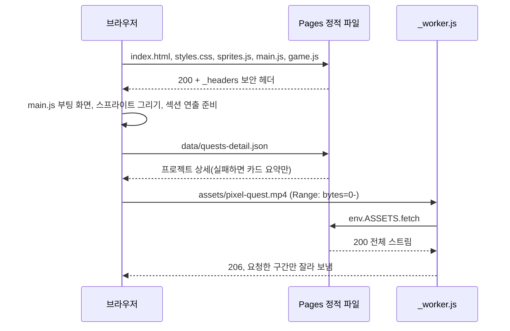
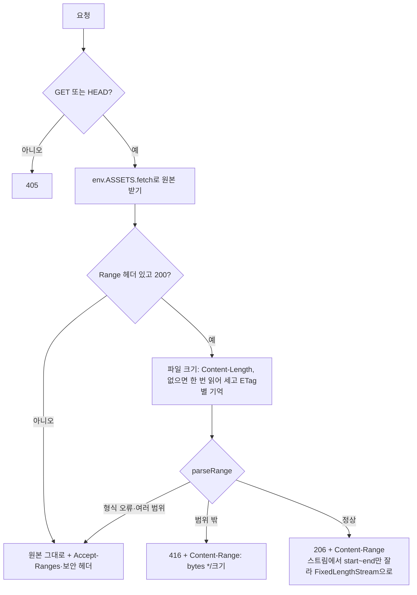
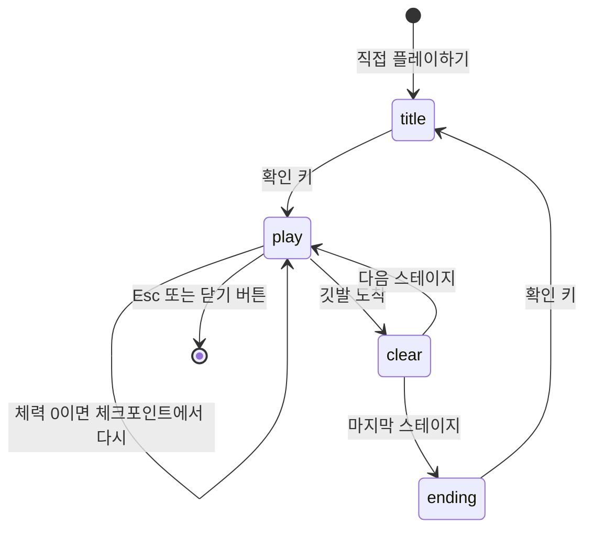

# 구현도 · SEUNGJUN QUEST

> 2026-11-05 `main`(`fbb62bf`) 기준. 무엇을 왜 만들었는지는 [기획서](기획서.md)·[설계서](설계서.md)에 있다.

## 폴더 구조

```
seungjun-quest/
├── index.html               # 섹션 마크업 7개 + 게임 창 + 스크립트 3개
├── styles.css               # 픽셀 UI, CRT 효과, 반응형, 모션 줄이기
├── sprites.js               # 팔레트 PAL, 스프라이트 격자 정의
├── main.js                  # 섹션 데이터(QUESTS·ITEMS)와 연출 전부
├── game.js                  # 직접 플레이 게임
├── data/
│   └── quests-detail.json   # 프로젝트 11개 상세 본문(노션에서 옮김)
├── assets/
│   ├── pixel-quest.mp4      # 소개 영상 (약 11MB)
│   ├── poster.jpg           # 영상 포스터, OG 이미지
│   ├── quest-bgm.m4a        # 게임 BGM
│   └── fonts/               # Galmuri11 보통·굵게
├── worker.js                # 배포 때 dist/_worker.js. 영상·음악 Range 응답
├── _headers                 # 정적 파일 보안 헤더
├── build.sh                 # dist/ 만들기
├── wrangler.jsonc           # Pages 프로젝트 이름, 출력 폴더 dist
├── legacy-redirect/         # 예전 Workers 주소 → 새 주소 301 (별도 Worker)
│   ├── index.js
│   └── wrangler.jsonc
├── docs/
│   ├── media/               # README용 스크린샷·영상 (배포 안 함)
│   └── (이 문서들, html/ 은 생성본)
└── README.md
```

## 모듈별 구역

### [`../main.js`](../main.js)

| 줄(대략) | 구역 |
|---|---|
| 6–119 | 데이터: `RARITY`, `QUESTS`(11개), `ITEMS` |
| 121–200 | 8비트 효과음(`tone`, 기본 꺼짐), 점수·코인, 파티클 `burst` |
| 202–232 | 부팅 화면, STATS 게이지 값 넣기, 별·패럴랙스, 소개 영상 재생 버튼 |
| 233–330 | 화면 진입 연출, 스크롤에 따른 HUD WORLD 표시, 월드맵 걷는 캐릭터(위치는 미리 재 두고 rAF에서 쓰기만) |
| 331–360 | ? 블록 |
| 362–508 | 퀘스트 저널: 탭·목록·상세, `renderBlocks`(노션 블록 → DOM, `textContent`만), 상세 JSON 불러오기 |
| 510–570 | 인벤토리, CONTINUE 카운트다운, 파티 스프라이트 |
| 571–590 | 코나미 커맨드 |

### [`../game.js`](../game.js)

| 줄(대략) | 구역 |
|---|---|
| 1–104 | 상수(W 320, H 192, 타일 16), `THEMES` 4종, `LEVELS` 5개 |
| 106–172 | 스프라이트 캐시 `spr`, 효과음 `SFX` |
| 173–236 | DOM, 입력(`KEYMAP`, 키보드, 터치 버튼 멀티터치) |
| 237–387 | 상태, `buildLevel`, 적·보스 만들기, 배경, `startLevel` |
| 388–495 | 효과, 물리 `moveBody`, 피격·처치·보스 피해 |
| 496–776 | 갱신 `updatePlay`·`update`(타이틀·플레이·클리어·엔딩 장면) |
| 777–1072 | 그리기: 배경·타일·플레이어·레벨·HUD·대사창·타이틀·클리어·엔딩 |
| 1073–1170 | 고정 60Hz 루프, 화면 맞춤 `fit`, BGM 동기화, 일시정지·소리, 열기·닫기 |
| 1171–1186 | `data-open-game` 버튼 연결, `?debug`일 때 `window.__quest` |

## 주요 흐름

### 페이지를 열 때



### Worker의 Range 처리



### 게임 한 판



- 장면 이름(`title`·`play`·`clear`·`ending`)은 `state.scene` 값이다. 전이는 `update()`에 있다.
- 보스 스테이지(2-1·3-1)는 깃발이 처음엔 없고, 보스를 잡으면 생긴다(`damageBoss`).
- 체력이 0이 돼도 게임 오버는 없다. 체력 3으로 체크포인트에서 다시 시작한다.

## 빌드·실행·배포

```bash
# 로컬에서 보기 (fetch 때문에 파일 직접 열기 대신 서버로)
python3 -m http.server 4173      # http://localhost:4173
                                  # 테스트 진입점: http://localhost:4173/?debug

# 배포
./build.sh && npx wrangler pages deploy

# 예전 주소 리다이렉트 Worker 배포 (바꿀 때만)
cd legacy-redirect && npx wrangler deploy
```

- `build.sh`는 `index.html styles.css main.js sprites.js game.js _headers data assets`를 `dist/`에 복사하고, `worker.js`를 `dist/_worker.js`로, `_routes.json`(`/assets/*.mp4`, `/assets/*.m4a`만 Worker)을 만든다.
- `docs/`는 배포하지 않는다.

## 버전·릴리스 현황

- 버전 번호·릴리스 태그가 없다. 원격 태그도 없다.
- 커밋은 `fbb62bf`(2026-10-16) 하나다. 그 전 작업 과정은 git에 없고 개발 글에만 남아 있다([결정기록](결정기록.md)).
- 로컬에만 `backup/pre-reset-20261105` 태그가 있다(2026-11-05에 로컬 `main`을 `origin/main`에 맞추기 전 끝, 내용은 같은 커밋 하나).

## 앞으로 할 일

- 계획된 작업은 기록이 없다.
- 고칠 때 볼 것:
  - 숫자를 바꾸면 `main.js` `QUESTS`, `data/quests-detail.json`, `index.html` `.qblock`·`#status`·`#map`, `game.js` `LEVELS`(표지판·? 블록·클리어 문구)를 같이 고친다.
  - 새 파일을 추가하면 `build.sh` 복사 목록에 넣는다.
