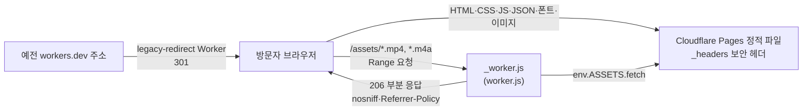
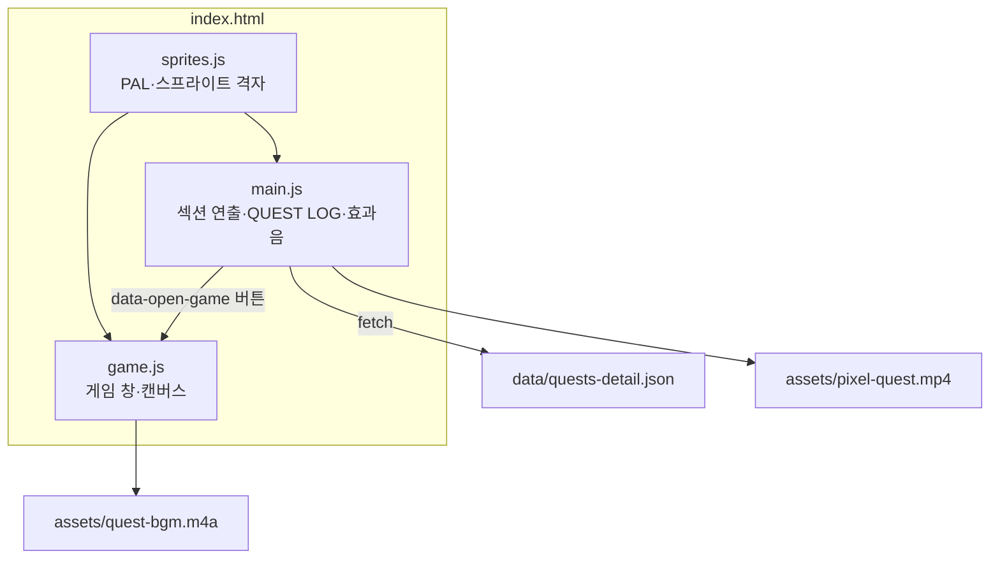

# 설계서 · SEUNGJUN QUEST

> 2026-11-05에 코드를 읽고 정리했다. 기능 범위는 [기획서](기획서.md), 파일·흐름은 [구현도](구현도.md)에 있다.

## 기술 스택과 고른 이유

| 영역 | 쓰는 것 | 고른 이유 |
|---|---|---|
| 화면 | HTML + CSS + 순수 JS, 프레임워크·빌드 도구 없음 | 섹션 7개짜리 한 페이지라 필요 없다(이유는 추정, 기록 없음). README에 "빌드 도구 없는 정적 사이트"라고 적혀 있다 |
| 게임 | Canvas 2D, 320×192 저해상도에 그리고 정수 배율로 키움, 로직 고정 60Hz | 픽셀이 뭉개지지 않고 기기마다 같은 물리가 나온다(`game.js` 첫 줄 주석) |
| 스프라이트 | `sprites.js`에 문자 격자로 정의(문자 하나 = 픽셀 하나) | 소개 영상과 같은 캐릭터를 쓴다 |
| 폰트 | Galmuri11(woff2, 저장소에 포함) | 픽셀 폰트. CSP가 `'self'`만 허용해 외부 폰트를 쓰지 않는다 |
| 소리 | Web Audio로 효과음 합성, BGM은 m4a 한 개 | 효과음 파일 없이 코드로 만든다 |
| 데이터 | `main.js` 안의 `QUESTS`·`ITEMS`, 프로젝트 본문은 `data/quests-detail.json` | 재료는 노션 하나로 두기로 했다([결정기록](결정기록.md#2026-10-15-재료는-노션-포트폴리오-하나로-둔다)) |
| 호스팅 | Cloudflare Pages + `_worker.js`(영상·음악만) | 정적 파일 응답이 Range를 처리하지 않아 iOS Safari에서 영상이 안 나왔다 |

### 결과물 형태 후보 (개발 글 기준)

| 후보 | 버린·고른 이유 | 결과 |
|---|---|---|
| 카드가 넘어가는 40초 영상 | 템플릿으로 찍은 회사 소개 영상 같았다 | 버림 |
| 맥북 터미널 영상(52초) | 개발자가 아니면 까만 화면일 뿐일 수 있다 | 영상은 만들었지만 사이트에는 넣지 않음 |
| 픽셀 게임 영상(67초) | 게임처럼 생겼으면 직접 해 볼 수 있어야 재밌다 | 사이트 소개 영상으로 씀 |
| 직접 플레이하는 게임 | 보는 사람이 가만히 있지 않아도 된다 | **채택** |

## 전체 아키텍처

- 스크립트 셋은 `<script src>`로 순서대로 불러온다. 인라인 스크립트는 없다(CSP).
- `main.js`와 `game.js`는 각각 즉시 실행 함수 안에 갇혀 있고, 전역으로 나오는 것은 `sprites.js`의 `PAL`·스프라이트 정의와 `?debug`일 때의 `window.__quest`뿐이다.

## 데이터 구조

| 데이터 | 위치 | 모양 |
|---|---|---|
| 프로젝트 카드 | `main.js` `QUESTS` (11개) | `{ cat, n, title, line(의뢰 내용), result(보상), keys[] }`. `cat`은 5가지 분류이고 `RARITY`로 등급 색을 붙인다 |
| 프로젝트 상세 | `data/quests-detail.json` | `{ "1": { title, sections: [{ heading, blocks: [{ type: "p"/"quote"/"ul"…, text 또는 items }] }] }, … "11": … }` |
| 기술 스택 | `main.js` `ITEMS` | `{ icon, name, desc, ai? }` |
| 경력·소개 | `index.html` `#status`, `#map` 섹션 마크업 | |
| 성과 | `index.html`의 `.qblock` 요소 `data-label`·`data-value`·`data-note` | |
| 게임 스테이지 | `game.js` `LEVELS` (5개) | `{ id, name, theme, len, pits, plats, items, enemies, signs, flag, clear, boss?, blocks? }`. 보스는 2-1·3-1에, ? 블록(`blocks`)은 2-2에만 있다. 좌표는 16px 타일 단위 |

- 저장소(localStorage 등)를 쓰지 않는다. 점수·코인은 페이지를 닫으면 사라진다.
- 상세 JSON을 못 불러오면 카드 요약만 보여 준다.

## 외부 의존

- 런타임에 부르는 외부 서비스·CDN이 없다. 모든 파일이 같은 출처에서 나온다.
- 배포 도구: `wrangler`(npx로 실행, 저장소에 package.json 없음).
- 소개 영상과 BGM은 저장소 밖 Remotion 프로젝트에서 만들어 넣었다(README).

## 플랫폼별 차이

| 환경 | 다른 점 |
|---|---|
| iOS Safari | 영상·음악을 Range 요청으로 받는다. Worker가 206을 만들어 줘야 재생된다 |
| 터치 기기(`pointer: coarse`) | 게임 아래 가상 패드가 나온다. 세로면 캔버스 아래 150px, 가로면 양옆 300px를 패드 자리로 뺀다 |
| 세로 화면 | 게임 창에 "가로로 돌리면 크게 보여요" 안내 |
| PC | 키보드 조작. 코나미 커맨드는 게임 창이 닫혀 있을 때만 받는다 |
| 모션 줄이기 설정 | `main.js`·`game.js`·`styles.css`가 `prefers-reduced-motion`을 보고 연출을 줄인다 |

## 보안·권한

- `_headers`(정적 파일):
  - `Content-Security-Policy: default-src 'self'; img-src 'self' data:; media-src 'self'; style-src 'self'; script-src 'self'; frame-ancestors 'none'; base-uri 'self'; form-action 'none'`
  - `X-Content-Type-Options: nosniff`, `Referrer-Policy: strict-origin-when-cross-origin`, `Permissions-Policy: camera=(), microphone=(), geolocation=()`
- CSP 때문에 HTML에 인라인 `<script>`와 `style` 속성을 쓰지 않는다. 동적 스타일은 JS에서 `element.style`로 넣는다(예: STATS 게이지 `data-v`).
- Worker를 거치는 영상·음악 응답에는 `_headers`가 붙지 않아 `worker.js`가 `nosniff`·`Referrer-Policy`를 직접 붙인다. GET·HEAD 외에는 405.
- 노션 본문은 `textContent`로만 DOM에 넣는다(`main.js` 주석). `innerHTML`은 코드 안 스프라이트 SVG에만 쓴다.
- 비밀값·키가 없다. 사이트에 공개하는 연락처는 메일 주소와 GitHub 링크다.
- 공개 저장소다. 문서에는 메일 외 개인정보를 넣지 않는다.

## 알려진 한계

- Worker는 `bytes=시작-끝` 범위 하나만 처리한다. 여러 범위 요청은 전체 응답으로 돌려준다.
- 파일 크기를 모르면 Worker가 파일을 한 번 끝까지 읽어 센다. ETag별로 기억하지만 Worker 인스턴스가 바뀌면 다시 센다.
- 소개 영상이 약 11MB라 느린 회선에서는 늦게 뜬다(`preload="metadata"`로 처음엔 앞부분만 받는다).
- 새 파일을 추가하면 `build.sh` 복사 목록에도 넣어야 배포된다. 빠뜨려도 경고가 없다.
- 프로젝트 데이터가 `main.js`·`quests-detail.json`·`index.html`·`game.js` 네 곳에 나뉘어 있어 숫자를 고치면 네 곳을 같이 봐야 한다.
- 자동 테스트 코드가 저장소에 없다. `?debug` 진입점만 있다.
- STATUS 능력치 게이지는 측정값이 아니라 연출이다(화면에도 그렇게 적혀 있다).
